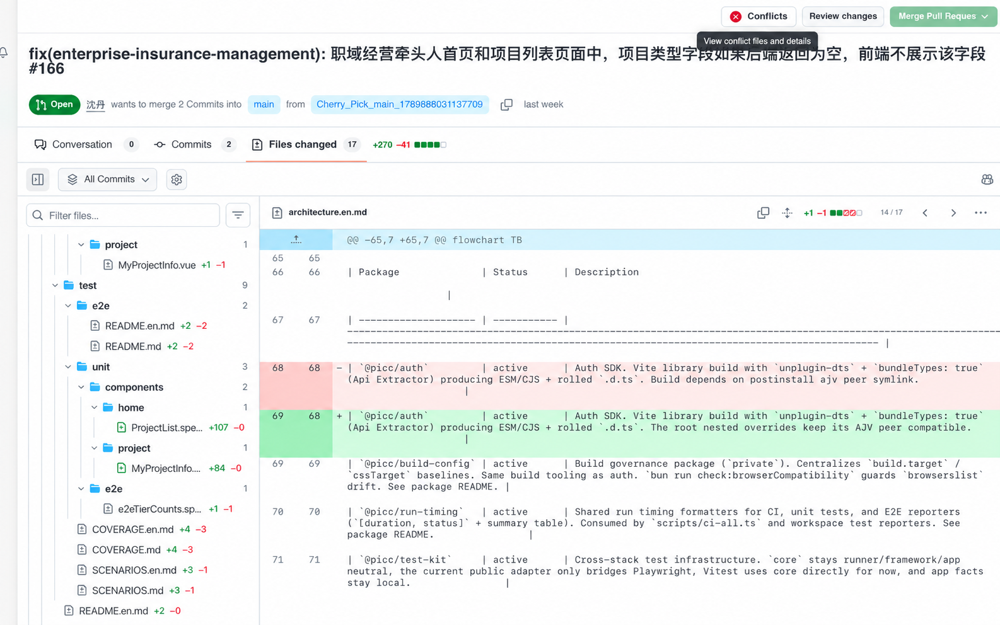
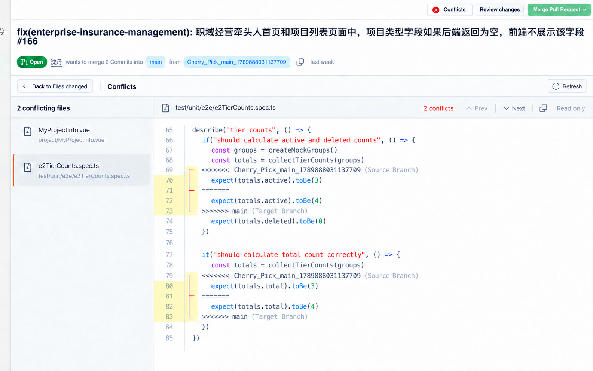

# PR Conflicts 设计图

状态：v5 待审核，尚未定稿。2026-09-28。采用用户提供的当前程序 PR 详情截图作为编辑底图，核对了 `ui/views/workflow/pr_review_workspace.slint`、`ui/components/pr_review/shell.slint` 与 Tooltip 样式。未实现应用 UI。

再次对照 [GitHub 官方 2025-10-02 冲突编辑器截图](https://github.blog/changelog/2025-10-02-one-click-merge-conflict-resolution-now-in-the-web-interface/)后重绘 v3：分支说明仅一处；左侧平铺文件；单一文件工具栏；代码 canvas 保持干净，冲突用 gutter 浅色和边界标记；不使用整行绿蓝 Diff 底色、额外分支横条或重复只读标签。该图是保留 Usher Shell 的只读适配，不是 GitHub 原样复刻或已批准的实施稿。完整规范已同步到[设计方案](../../pr-conflicts-design.zh.md)。

本组取代此前脱离现有 UI 的通用网页概念图。保留当前 PR 页头、操作按钮、字体风格、Branch 标签和分隔线；冲突文件使用 GitHub 参考的平铺列表，代码区域采用简化工具栏。不添加新全局侧栏、品牌 logo、面包屑、提示横幅或永久第四个 Tab。冲突状态入口使用现有顶部 Conflicts 按钮。

## 详情页入口

点击现有 Conflicts 按钮进入独立子视图。图中展示其查看入口 Tooltip，正常 Files changed 布局保留。



## 冲突文件与详情

原 Tab 区切为局部返回和 Conflicts 标题；左侧平铺冲突文件，右侧为单列只读冲突内容和逐块导航，marker 附近明确标注 Source/Target Branch，代码主体保留白底。冲突范围以 gutter 局部浅黄和括号边界标记突出，不加入编辑、标记或提交操作。图中顶部原有 Review/Merge 操作属于 PR Shell，实际启用状态继续由现有 readiness/能力控制，不能由本地分析启用 Merge。

v4 对照用户补充的 GitHub 原图修正 gutter：括号为 `[`，竖线在左，顶部、分隔处与底部短横线向右伸向代码，设计线宽为 1 个逻辑像素并在实施时按设备像素对齐。浅黄色覆盖冲突范围的行号背景，数字仍为灰色；按参考图细节，起始 marker 行的数字格保留白底，旁边括号区域从起始行至结束行均为浅黄色。示例中黄色数字格是 70–73、80–83 行，69、79 行数字格保持白底。颜色需通过主题语义 token 适配暗色主题。

v5 修正 v4 实际漏绘的起始行括号槽背景：`<<<<<<<` 行也属于黄色范围，窄括号槽连续覆盖 69–73、79–83 行。数字格与括号槽是两个不同区域，不能把起始数字格的白底解释为整行不高亮。该阶梯形边界仅描述所提供 GitHub 截图的可见效果，不能据此断言所有 GitHub 版本的绘制规则。已对两处起始行背景进行像素抽样，确认由白色改为浅黄色。



旧版[文件树与整行底色稿](../../archive/pr-conflicts-20261014/conflicts-workspace-current-ui.en.png)、[括号、行号背景修正前 v3](../../archive/pr-conflicts-20261014/conflicts-workspace-github-reference-v3.en.png)和[起始行括号槽漏绘的 v4](../../archive/pr-conflicts-20261014/conflicts-workspace-github-reference-v4.en.png)只作历史对照，不作为实施参考。

这两张图按底图的当前 English UI 展示。PR 标题、作者与 Branch 来自底图；冲突文件数量、块数及代码是设计示例，不代表实际 PR 查询结果。图像是概念编辑结果，不是运行中的 Slint 功能截图，文字与尺寸以实施时的组件和 catalog 为准。

i18n 属于第一批必验：所有应用文案使用共享语义 catalog，支持全部内置 locale；运行时切换即时更新，源码、路径、Branch 和用户 PR 标题保持原文。详见[完整设计](../../pr-conflicts-design.zh.md)的多语言契约。最终程序不使用这些位图作为 UI。

生成工具：内置 `image_gen`，参考图编辑模式。最终生成约束分别是：

- 入口图：直接编辑当前程序截图，保留全部现有界面；移除用户红色标注，并用现有 Primer Tooltip 风格表示查看冲突文件与详情的入口。
- 工作区图：保留原截图页头、操作区、字体、边框和左右栏比例；仅将内容区切为独立只读 Conflicts 子视图，加入返回、冲突文件树和冲突块导航；禁止增加全局导航、横幅和解决/提交动作。
- v3 工作区：以用户发回的上版截图为底图编辑，保留现有程序页头；删除重复 Branch 行和色带，改为平铺文件列表、一个文件工具栏、白底代码与浅黄 gutter/括号冲突范围。依据官方截图逐项核对，删除所有写入操作；未使用官方截图作为生成图冒充真实页面。
- v4 工作区：以 v3 为编辑目标、用户提供的 GitHub 截图为 gutter 参考，只修正两处括号方向、线宽与行号背景。已检查生成结果中两块括号均朝右，冲突行号底色为浅黄、数字为灰色，代码区域保持白底。
- v5 工作区：内置 image_gen 定点修正两处起始行括号槽的白色缺口；最终提示要求仅在约 x=495–529、y=440–469 和 y=723–752 的背景补上与下方连续的浅黄色，保留前景红色细括号及全部布局、文字。生成后目视核对并抽样确认两处起始行已呈黄色。位图不作为生产环境精确像素或主题色验收依据。

<details>
<summary>v4 内置 image_gen 编辑提示词</summary>

```text
Edit image 1 only, retaining its entire existing Usher desktop PR conflict preview UI and exact layout, size, header, file list, toolbar, code text, line numbers and typography. Image 2 is the real GitHub reference ONLY for the yellow conflict gutter and bracket details. Make a narrowly targeted correction to the two conflict ranges in image 1, at displayed lines 69–73 and 79–83. Replace each existing thick right-stem orange ] bracket with a THIN rust/red [ bracket: vertical stem on the LEFT, short top, middle and bottom ticks extending RIGHT toward code; the middle tick aligns with =======. Stroke approximately 1 logical pixel, subtle, matching image 2. Keep a pale yellow narrow bracket lane behind each whole conflict range (69–73 and 79–83). Extend the pale yellow background across the line-number cells ONLY on lines 70,71,72,73 and 80,81,82,83. The starting marker number cells 69 and 79 must remain WHITE, exactly like line 3 in the GitHub reference. All line-number digits remain muted gray, not yellow. Outside these ranges the gutter stays white. Code canvas remains white: do not introduce colored whole-code-row backgrounds. Do not import image 2's title, text, buttons, Accept actions, Mark as resolved, editing UI or layout. Everything else in image 1 must remain unchanged. Produce a polished exact targeted revision of image 1, without annotations, arrows or comparison framing.
```

</details>
